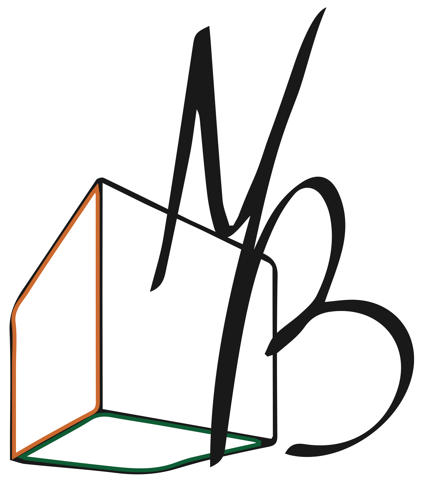

 
 
Find me on 
 
 
 

### 📌 Remember

	Make the impossible possible, the possible easy, the easy elegant.
	~ Dr Moshe Feldenkrais
 

### 🧠 Skills and Techs

 
 
 

### 📈 Stats

<!--  -->

<!-- Resources -->

<!-- Badges
	https://shields.io/
	-->
<!-- Icons
	https://simpleicons.org/
	https://www.base64-image.de/
 	https://javascript.plainenglish.io/how-to-make-custom-language-badges-for-your-profile-using-shields-io-d2aeaf016b6b
	-->
<!-- Emojis
	https://emojipedia.org/emoji/
	https://www.fileformat.info/index.htm
	-->
<!-- GitHub Stats
	https://github.com/anuraghazra/github-readme-stats
	https://github.com/DenverCoder1/github-readme-streak-stats
	-->
<!-- Awesome GitHub Profile README
	https://github.com/abhisheknaiidu/awesome-github-profile-readme
	-->
